<!-- Auto-generated from profile.json by scripts/generate_profile.py — edit profile.json to update! -->

  

  
  
  
  

  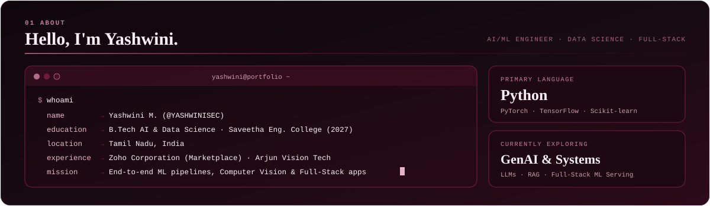

 

  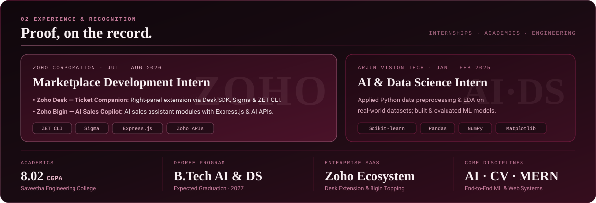

 

  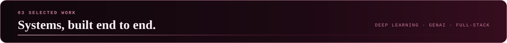

  <a href="https://github.com/YASHWINISEC/Brain-Tumor-Detection-using-Vision-Transformer">
    
  </a>

  

  

  

  <a href="https://github.com/YASHWINISEC/genai-image-captioning-blip">
    
  </a>

  
  

  <a href="https://github.com/YASHWINISEC/Implementation-of-Linear-Regression-Using-Gradient-Descent">
    
  </a>

  
  

 

  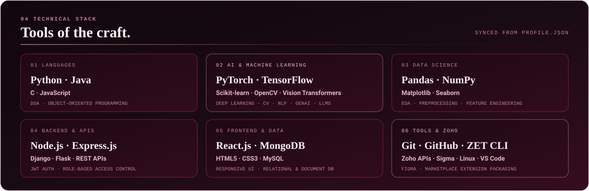

 

  <a href="https://github.com/YASHWINISEC">
    
  </a>

 

  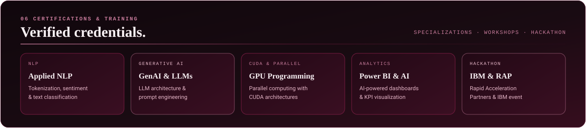

 

  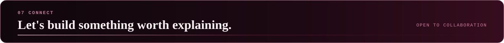

  
  
  

  

