  

  <a href="https://github.com/YASHWINISEC">GitHub</a>
  &nbsp;·&nbsp;
  <a href="https://github.com/YASHWINISEC?tab=repositories">Repositories</a>

## About

I’m **Yashwini M.**, a B.Tech student in **Artificial Intelligence and Data Science** at **Saveetha Engineering College**, graduating in 2027.

I enjoy turning ideas into practical software — from machine learning experiments and computer-vision applications to data-driven tools and full-stack integrations. I’m especially interested in building useful AI systems and understanding how they work end to end.

## Education

**B.Tech — Artificial Intelligence and Data Science**  
Saveetha Engineering College · Expected graduation: 2027

## Experience

**Marketplace Development Intern — Zoho Corporation**

Worked on Zoho Marketplace development involving Zoho Desk extensions and Zoho Bigin toppings, using the Zoho Extension Toolkit (ZET) and platform APIs.

Selected work:
- **Ticket Companion — Zoho Desk:** a right-panel Desk extension built with the Zoho Desk Extension SDK and ZET.
- **AI Sales Copilot — Zoho Bigin:** an AI-assisted sales productivity topping developed using JavaScript, Express.js, ZET, and AI API integration.

## Selected Projects

### [Brain Tumor Detection Using Deep Learning](https://github.com/YASHWINISEC/Brain-Tumor-Detection-using-Vision-Transformer)
A Flask-based brain MRI classification application using a **CNN built with PyTorch**. It classifies images into glioma, meningioma, no-tumor, and pituitary categories, displays a predicted class and confidence score, and provides Grad-CAM visualizations.

**Technologies:** Python · PyTorch · Torchvision · CNN · Flask · OpenCV · Grad-CAM

> Educational and research use only; this project is not a medical diagnostic tool.

### [Image Captioning Using BLIP](https://github.com/YASHWINISEC/genai-image-captioning-blip)
A prototype image-captioning application using the pre-trained Salesforce BLIP image-captioning model, with a Gradio interface for image input and generated text output.

**Technologies:** Python · PyTorch · Hugging Face Transformers · BLIP · Gradio · Pillow

### [PDF Question-Answering Chatbot](https://github.com/YASHWINISEC/genai-pdf-qa-chatbot)
A PDF question-answering prototype that extracts document text, creates a searchable vector representation, and uses a retrieval-based question-answering workflow to respond to document queries.

**Technologies referenced in the project:** Python · LangChain · FAISS · Hugging Face · PyPDF2

### [Linear Regression Using Gradient Descent](https://github.com/YASHWINISEC/Implementation-of-Linear-Regression-Using-Gradient-Descent)
An implementation exercise exploring linear regression, gradient-descent updates, prediction, and loss visualization on a startup-profit dataset.

**Technologies:** Python · NumPy · Pandas · Scikit-learn · Matplotlib

### [Customer Segmentation Using K-Means](https://github.com/YASHWINISEC/Implementation-of-K-Means-Clustering-for-Customer-Segmentation)
A customer-segmentation exercise applying K-Means clustering to annual income and spending-score features, with cluster and centroid visualizations.

**Technologies:** Python · Pandas · NumPy · Scikit-learn · Matplotlib

## Technical Skills

| Category | Technologies |
|---|---|
| Programming | Python, Java, C, C++, JavaScript |
| AI / ML | Machine Learning, Deep Learning, TensorFlow, PyTorch, Scikit-learn, OpenCV, NLP, Generative AI |
| Data Science | Pandas, NumPy, Matplotlib, Seaborn, data preprocessing, exploratory data analysis |
| Web Development | HTML, CSS, React, Node.js, Express.js, MongoDB, Django, Flask |
| Tools & Platforms | Git, GitHub, MySQL, VS Code, Zoho Extension Toolkit (ZET), Zoho APIs |

## Currently Learning

- Data Structures and Algorithms using Java
- End-to-end machine learning workflows
- Generative AI and practical LLM applications
- Full-stack application development

## GitHub Activity

  

Contribution activity is loaded from a third-party chart service using public GitHub contribution data. If the chart does not load, view the <a href="https://github.com/YASHWINISEC">GitHub profile</a> directly.

## Connect

- **GitHub:** [@YASHWINISEC](https://github.com/YASHWINISEC)

---

  

